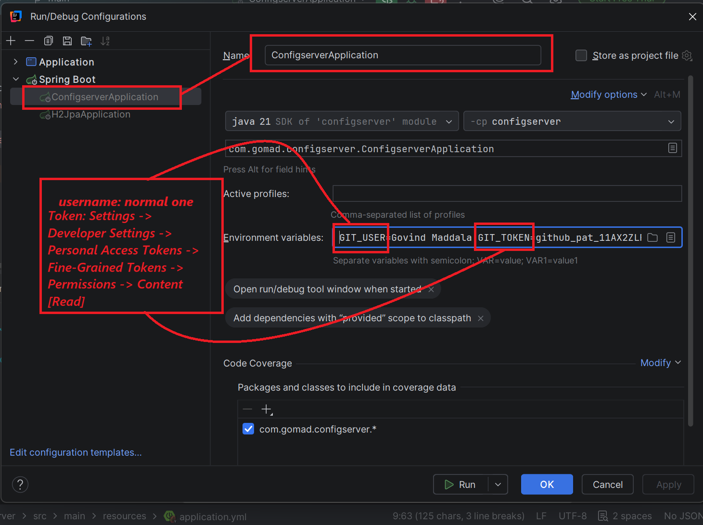
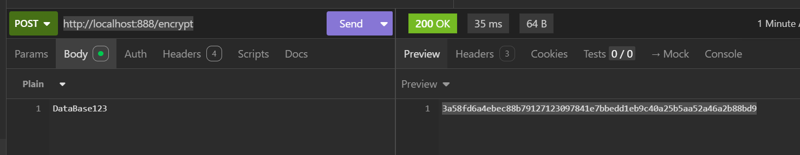
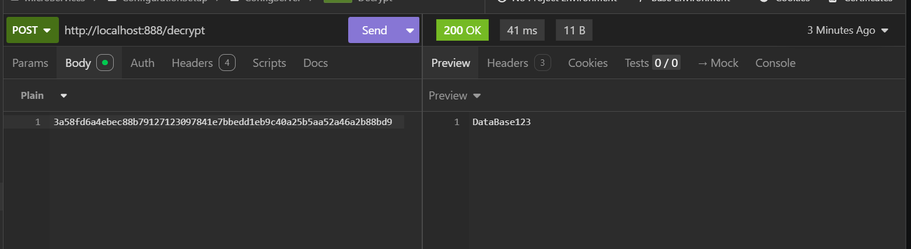
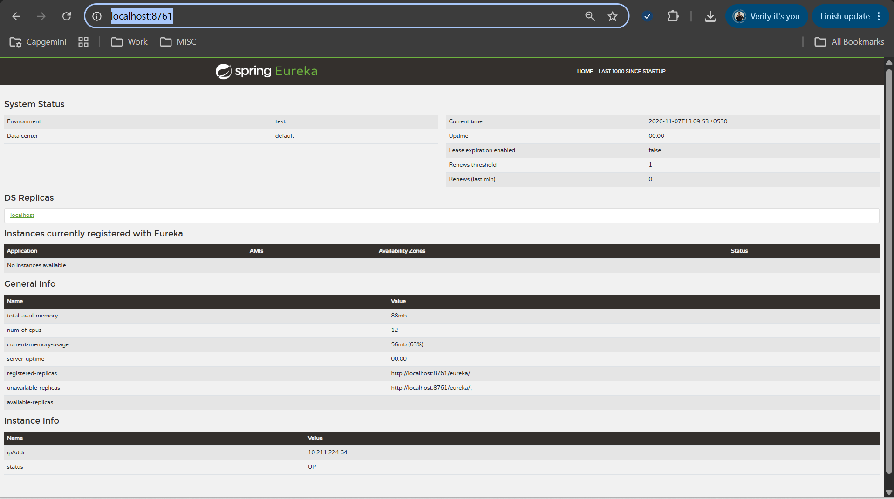
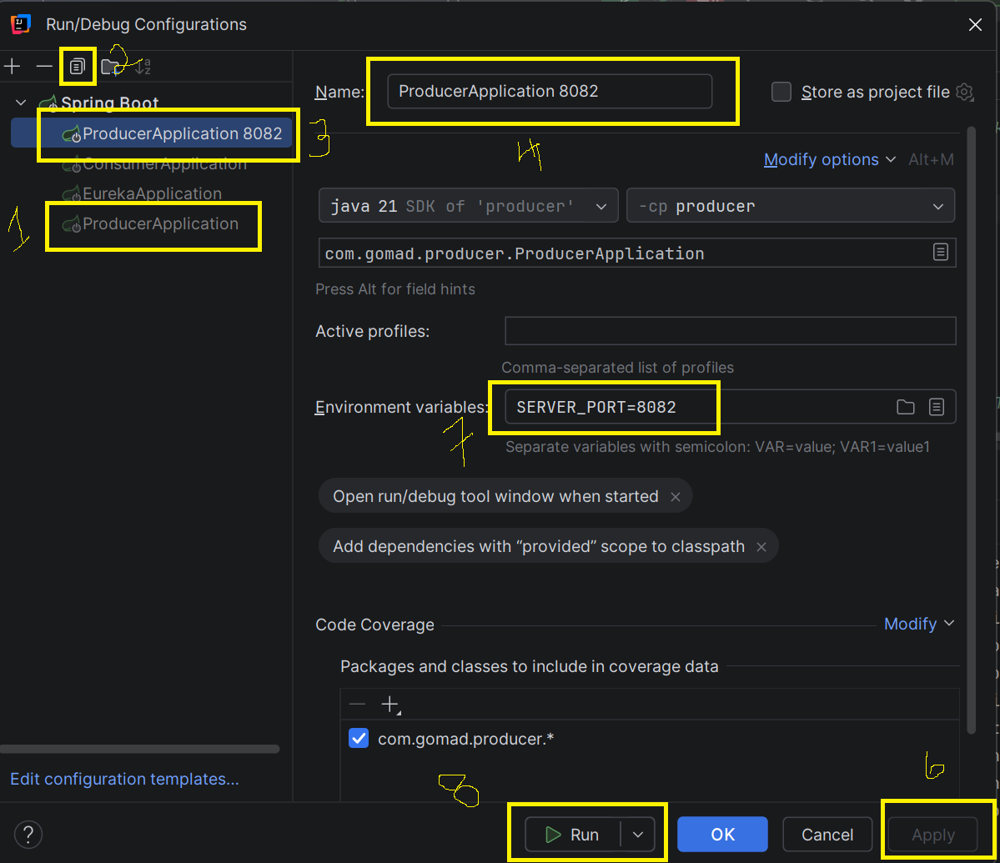

# Microservices

## Spring Cloud Config and H2 JPA
- Let's say now we have config files in some cloud or git, then we have to get on to one server and other clients will use them.

### Spring Cloud Server and setup:
- Create server with ```spring-cloud-config-server``` dependency.
- In ```ConfigserverApplication``` file, add **@EnableConfigServer** annotation.
- In application.yml, add like 
  ```yaml
  spring:
    application:
      name: configserver

    cloud:
      config:
        server:
          git:
            uri: https://github.com/govindmaddala2107/app-config
            
            # If git repo is private add username and password
            username: ${GIT_USER}
            password: ${GIT_TOKEN}

    logging:
      level:
        org.springframework.cloud.config.server: ERROR

    server:
      port: 888
  ```
- If git repo is private add username and password and hard code the value in yml file or pass from envi variables like below mentioned image:
  - GIT_USER and GIT_TOKEN has to be passed from 
  

#### Git setup 
  - Also create some config.yml fine in git [for example] [app-config](https://github.com/govindmaddala2107/app-config) repo in git with yml files with names exactly equal app names of microservices:
    - for example ```spring.application.name=h2jpa``` file name should be 
      - default: h2jpa.yml
      - dev: h2jpa-dev.yml
      - prod: h2jpa-prod.yml

##### Accessing endpoints of :
  - [default h2Jpa yml](http://localhost:888/h2jpa/default)
    ```json
    {
      "name": "h2jpa",
      "profiles": [
        "default"
      ],
      "label": null,
      "version": "e016839489ea9dbc4b12c8a3695c484d96a263f0",
      "state": "",
      "propertySources": [
        {
          "name": "https://github.com/govindmaddala2107/app-config/h2jpa.yml",
          "source": {
            "spring.application.name": "h2jpa",
            "spring.h2.console.enabled": true,
            "spring.datasource.url": "jdbc:h2:mem:testdb",
            "build.id": 102,
            "build.version": "v3",
            "build.date": 31102026,
            "server.servlet.context-path": "/api/public"
          }
        }
      ]
    }
    ```
    - [dev h2Jpa yml](http://localhost:888/h2jpa/dev)
      ```json
      {
        "name": "h2jpa",
        "profiles": [
          "dev"
        ],
        "label": null,
        "version": "6f2fe9d5040970e096abdd97e6b2ec985a861d12",
        "state": "",
        "propertySources": [
          {
            "name": "https://github.com/govindmaddala2107/app-config/h2jpa-dev.yml",
            "source": {
              "spring.application.name": "h2jpa",
              "spring.h2.console.enabled": true,
              "spring.datasource.url": "jdbc:h2:mem:dev",
              "build.id": 101,
              "build.version": "dev1",
              "build.date": 31102026,
              "server.servlet.context-path": "/api/public"
            }
          },
          {
            "name": "https://github.com/govindmaddala2107/app-config/h2jpa.yml",
            "source": {
              "spring.application.name": "h2jpa",
              "spring.h2.console.enabled": true,
              "spring.datasource.url": "jdbc:h2:mem:testdb",
              "build.id": 102,
              "build.version": "v3",
              "build.date": 31102026,
              "server.servlet.context-path": "/api/public"
            }
          }
        ]
      }
      ```


### Spring Cloud Client and setup:
- Now here we want to access details from server.
- Dependencies needed are:
  - spring-cloud-starter-config [for client setup]
  - spring-boot-starter-actuator [for refresh the server without downtime and to fetch latest changes in config]
- Code Setup:
  - Before:
    ```yaml
    spring:
      application:
        name: h2jpa
      config:
        import: configserver:http://localhost:888
      h2:
        console:
          enabled: true
      datasource:
        url: jdbc:h2:mem:testdb
    ```
  - After Config Client setup:
    ```yaml
    spring:
      application:
        name: h2jpa
      config:
        import: configserver:http://localhost:888
    server:
      servlet:
        context-path: /api/public

    # It is to enable refresh server with actuator
    management:
        endpoints:
          web:
            exposure:
              include: refresh
    ```
- Now let's say config values changed in git, now using acuator, we can hit refresh api to restart the server and can hit the api to get updated values:
  - To create this scenario, I have created an api to fetch build details. 
  - In git, in h2jpa.yml I kept:
    ```yaml
    build:
    id: 102
    version: v3
    date: 31102026
    ```
    - [Build Info](http://localhost:8080/api/public/build-info) returns
      ```json
      {
        "id": 102,
        "version": "v3",
        "date": 31102026
      }
      ```
  - Now I have updated values in git, in h2jpa.yml like 
    ```yaml
    build:
    id: 103
    version: updated4
    date: 31102026
    ```
  - Now on hitting [Build Info](http://localhost:8080/api/public/build-info) returns same 
    ```json
    {
      "id": 102,
      "version": "v3",
      "date": 31102026
    }
    ```
  - To get updated values, we have to restart h2jpa app in general, but with spring actuator refresh, it is very easy:
    - hit POST call [Actuator Refresh](http://localhost:8080/api/public/actuator/refresh) with request body and we will get changes in response like below:
      ```json
      [
        "config.client.version",
        "build.version",
        "build.id",
        "build.date"
      ]
      ```
  - Now on hitting building-info, i will get updated data:
    ```json
    {
      "id": 103,
      "version": "updated4",
      "date": 31102026
    }
    ```

### Storing Configurations in Database for Dynamic Updates:
  - Here we can store configuration settings in database and can use.
  - Dependencies needed are:
    - ```JDBC API ```
      - Database Connectivity API that defines how a client may connect and query a database.
    - ```PostgreSQL Driver [Any SQL Database]```
      - A JDBC and R2DBC driver that allows Java programs to connect to a PostgreSQL database using standard, database independent Java code.
  - Config Server application.yml settings are as follow:
    ```yaml
    spring:
      application:
        name: configserver
      profiles:
        active: jdbc
      datasource:
        url: jdbc:postgresql://localhost:5432/configdb
        username: postgres
        password: postgres
        driver-class-name: org.postgresql.Driver
      cloud:
        config:
          server:
            jdbc:
              sql: >
                SELECT PROP_KEY, PROP_VALUE
                FROM PROPERTIES
                WHERE APPLICATION=? AND PROFILE=? AND LABEL=?
              default-label: main
    ```
  - spring.profiles.active should be **jdbc** when we use database for configuration, else springboot will consider git.

### File-Based Configuration:
- Also we can keep file based configuration and it is called as **native** configuration.
- #### Cloud Server Setup:
  - create **config** folder in ```configserver > src > main > resources > config``` and create files for project **h2jpa** like:
    - h2jpa.yml [keep content of h2jpa.yml file present in git]
    - h2jpa-dev.yml [keep content of h2jpa-dev.yml file present in git]
      - i.e file name should be alike application name.
  - Now in **application.yml** keep config like:
    ```yaml
    spring:
      application:
        name: configserver
      profiles:
        active: native # to tell to use local file system
      cloud:
        config:
          server:
            native:
              search-locations: classpath:/config # to check config folder in resources
    logging:
      level:
        org.springframework.cloud.config.server: ERROR

    server:
      port: 888
    ```
- #### Cloud Client Setup:
  - Now in client, delete all *.yml files and keep **application.yml** and keep
    ```yml
    spring:
      application:
        name: h2jpa
      config:
        import: configserver:http://localhost:888
      profiles:
        active: dev
    ```
  - [Build-Info-With-Files](http://localhost:8080/api/public/build-info) returns like 
    - In General, it returns content from h2jpa.yml
      ```json
      {
        "id": 101,
        "version": "NativeDefault",
        "date": 31102026
      }
      ```
    - for spring.profiles.active = "dev", returns content from h2jpa-dev.yml
      ```json
      {
        "id": 101,
        "version": "NativeDev",
        "date": 31102026
      }
      ```
    
  

- #### Dynamic updation of Config using RabbitMQ:
  - ##### RabbitMQ setup:
    - ###### Setup in Machine
      - RabbitMQ can be installed locally but using docker we can install it by 
        ```powershell
        # latest RabbitMQ 4.x
        docker run -it --rm --name rabbitmq -p 5672:5672 -p 15672:15672 rabbitmq:4-management
        ```
      - rabbitmq runs on port 5674 and rabbitmq-management runs on 15672.
      - default credentials are guest and guest.
    - ###### Setup in Springboot project:
      - Dependency need is 
        ```xml
        <dependency>
          <groupId>org.springframework.cloud</groupId>
          <artifactId>spring-cloud-starter-bus-amqp</artifactId>
        </dependency>
        ```
      - setup in application.yml is
        ```yaml
        spring
            rabbitmq:
              host: localhost
              port: 5672
              username: guest
              password: guest

        management:
          endpoints:
            web:
              exposure:
                include: "*" # to include /busrefresh 
        ```
        - this could subscribe our springboot project to rabbitmq.
    

  - ##### Other required configuration for Dynamic updation:
    - ##### Config Server setup: 
      - **Dependencies needed:** 
        - Actuator
        - Spring Boot Starter AMQP
        ```xml
        <dependency>
          <groupId>org.springframework.boot</groupId>
          <artifactId>spring-boot-starter-actuator</artifactId>
        </dependency>
        <dependency>
          <groupId>org.springframework.cloud</groupId>
          <artifactId>spring-cloud-starter-bus-amqp</artifactId>
        </dependency>
        ```
        - Same dependencies are needed for **Config Client** also.
      - **Config setup:**
        - Before setup is 
          ```yaml
          spring:
            application:
              name: configserver
            profiles:
              active: native
            cloud:
              config:
                server:
                  native:
                    search-locations: file:///C:\Users\EDIUS X\Desktop\gomad\microservices\microservices_config\configserver\src\main\resources\config
          #          search-locations: classpath:/config
            rabbitmq:
              host: localhost
              port: 5672
              username: guest
              password: guest

          management:
            endpoints:
              web:
                exposure:
                  include: "*"
          server:
            port: 8888
          ```
        - for dynamic updation classpath should not be used because on application startup, it will bundle the config files when we configure with classpath.
        - So for this, configuration will be like: **file:** followed by **///** and **full path of config** folder.
      
    - ##### COnfig Client Setup:
      - **Dependencies needed:**
        - actuator and Spring Boot Starter AMQP
      - **Config setup:**
        - Almost no changes but only we add actuator endpoints inclusion and rabbitmq subscription
        ```yaml
        spring:
          application:
            name: orders
          config:
            import: optional:configserver:http://localhost:8888
          rabbitmq:
            host: localhost
            port: 5672
            username: guest
            password: guest

        management:
          endpoints:
            web:
              exposure:
                include: "*"

        server:
          port: 8082
        ```
    - ###### API Endpoints using:
      - [Orders Config details-Dev](http://localhost:8888/orders/dev)
        ```json
        {
          "name": "orders",
          "profiles": [
            "dev"
          ],
          "label": null,
          "version": null,
          "state": null,
          "propertySources": [
            {
              "name": "file:/C:/Users/EDIUS X/Desktop/gomad/microservices/microservices_config/configserver/src/main/resources/config/orders-dev.yml",
              "source": {
                "build.id": 101,
                "build.version": "NativeDev",
                "build.date": 1086486
              }
            },
            {
              "name": "file:/C:/Users/EDIUS X/Desktop/gomad/microservices/microservices_config/configserver/src/main/resources/config/orders.yml",
              "source": {
                "build.id": 101,
                "build.version": "NativeDefault",
                "build.date": 1086486
              }
            }
          ]
        }
        ```
      - [Orders Built Info](http://localhost:8082/build-info)   
        - Active profile is default
        ```json
        {
          "id": 101,
          "version": "NativeDefault",
          "date": 1086486,
          "service": "orders"
        }
        ```
      - Let's say version is changed from "NativeDefault" to "NativeDefaultUpdated"
        - Automatically in config server, it will update, no need of refresh but to get updated one in Clients, you need to run **/busrefresh** on either client or server [anything works fine].
      - Now make sure docker is running and run POST method [BusRefresh](http://localhost:8888/actuator/busrefresh) and [Orders Built Info](http://localhost:8082/build-info) will return 
        ```json
        {
          "id": 101,
          "version": "NativeDefaultUpdated",
          "date": 1086486,
          "service": "orders"
        }
        ```
    - ###### Dependencies nee
### Spring Cloud Config Encryption (`encrypt.key`)

##### Why do we need `encrypt.key`?

In real-world applications, configuration files often contain sensitive information such as:

- Database passwords
- API keys
- OAuth client secrets
- SMTP passwords
- Third-party service credentials

Storing these values in plain text inside Git repositories is a security risk.

Spring Cloud Config Server provides encryption support so that sensitive values can be stored in encrypted form inside the Config Repository.

---

##### Configuration

```yaml
encrypt:
  key: my-secret-encryption-key
```

Example:

```yaml
encrypt:
  key: Govind@2026#SecretKey
```

The Config Server uses this key to:

- Encrypt plain text values
- Decrypt encrypted values before sending them to clients

---

##### How It Works

###### Step 1: Encrypt a Secret

Request:

```http
POST /encrypt
Content-Type: text/plain

mypassword
```

Response:

```text
AQBXCDFGH123456...
```

---

###### Step 2: Store in Config Repository

Instead of:

```yaml
spring:
  datasource:
    password: mypassword
```

Store:

```yaml
spring:
  datasource:
    password: "{cipher}AQBXCDFGH123456..."
```

Commit the file to Git.

---

###### Step 3: Client Fetches Configuration

Client Application:

```yaml
spring:
  config:
    import: configserver:http://localhost:8888
```

When the client requests configuration:

```text
http://localhost:8888/myapp/default
```

Config Server automatically decrypts:

```yaml
password: "{cipher}AQBXCDFGH123456..."
```

and returns:

```yaml
password: mypassword
```

The client never needs to perform decryption.

---

###### Real-Time Example

###### Config Repository

```yaml
spring:
  datasource:
    username: postgres
    password: "{cipher}AQBXCDFGH123456..."
```

###### Config Server

```yaml
encrypt:
  key: Govind@2026#SecretKey
```

###### Client Application

```yaml
spring:
  config:
    import: configserver:http://localhost:8888
```

Result:

```java
@Value("${spring.datasource.password}")
private String password;
```

Value received:

```text
mypassword
```

even though Git contains only the encrypted value.

---

###### Security Benefits

✅ Passwords are not stored in plain text

✅ Developers cannot easily view production secrets

✅ Safe to keep encrypted values in Git

✅ Centralized secret management

✅ Applications receive decrypted values transparently

---

###### Best Practice

- ###### Avoid Hardcoding
  - Instead of:
  ```yaml
  encrypt:
    key: my-secret-key
  ```

Use:

```yaml
encrypt:
  key: ${ENCRYPT_KEY}
```

Windows:

```cmd
set ENCRYPT_KEY=MySuperSecretKey
```

Linux:

```bash
export ENCRYPT_KEY=MySuperSecretKey
```

---


##### Changing the Key

If you change:

```yaml
encrypt:
  key: old-key
```

to

```yaml
encrypt:
  key: new-key
```

all previously encrypted values become invalid and must be encrypted again.

---

##### Use Strong Keys

Bad:

```yaml
encrypt:
  key: password
```

Good:

```yaml
encrypt:
  key: G0v!nd@2026#ConfigServer$Secret
```

---

##### Typical Production Usage

```text
Git Repository
     │
Encrypted Secrets
     │
     ▼
Spring Cloud Config Server
(encrypt.key)
     │
Decrypts Values
     │
     ▼
Microservices
Receive Plain Text Configuration
```

---

###### Summary

`encrypt.key` is used by Spring Cloud Config Server to encrypt and decrypt sensitive configuration values such as database passwords, API keys, and secrets. It allows secure storage of configuration in Git while transparently providing decrypted values to client applications at runtime.

###### Cloud Server exposes 2 endpoints:
- Encrypt:
  - [Encrypt Text](http://localhost:888/encrypt) accepts text content and returns encrypted content:
  
- Decrypt:
  - [Decrypt Text](http://localhost:888/decrypt) accepts encrypted content and returns decrypted content:
  
- For encryption and decryption, encrypt.key will be used.

##### Keystore & RSA Key Pair:
- Instead of storing a plain-text encryption key directly in application.yml, Spring Cloud Config can use a Java Keystore.

- A Keystore is a secure file that stores encryption keys and certificates.

- Using the Java keytool utility, an RSA key pair (public key and private key) can be generated and stored inside the keystore.

- Spring Cloud Config Server uses the key pair from the keystore to:
  - Encrypt sensitive data (e.g., database passwords)
  - Decrypt encrypted values before sending configuration to clients

- ##### Benefits:
  - More secure than storing encryption keys in plain text
  - Easier key management
  - Suitable for production environments
  - Supports asymmetric encryption using RSA key pairs
- ##### How Encryption and Decryption Work with a Keystore

  - ###### Encryption

    - When a sensitive property (e.g., a database password) needs to be secured, Spring Cloud Config Server uses the **public key** from the RSA key pair stored in the keystore to encrypt the value.

      ```text
      Plain Text Password
              |
              v
      Public Key
              |
              v
      Encrypted Value ({cipher}...)
      ```

    - The encrypted value can then be safely stored in the Git configuration repository.

  - ###### Decryption

    - When a client application requests configuration from the Config Server, the server uses the **private key** from the keystore to decrypt the encrypted property before returning it.
      ```text
      Encrypted Value ({cipher}...)
                |
                v
            Private Key
                |
                v
          Plain Text Value
      ```

    - The client receives the actual value and does not need to perform any decryption.
  - ###### Why Use a Key Pair?
    - Public key is used for encryption.
    - Private key is used for decryption.
    - Private key remains securely stored in the Config Server.
    - Sensitive values can be safely stored in Git repositories.
    - More secure than storing a plain text encryption key.

  - ###### Flow
    ```text
    Client Secret
        ↓
    Encrypt (Public Key)
        ↓
    Store in Git Repository
        ↓
    Config Server Reads Value
        ↓
    Decrypt (Private Key)
        ↓
    Send Plain Text to Client Application
    ```
- ##### How RSA is different from AES ?
  - AES is like having **one master key** for a safe, while **RSA** is like having a **lock and key pair** where
    - one key is public [which can be exposed/shared to public] (to lock i.e encryption) and
    - another key is private [we will keep it with us secretly] (to unlock i.e decryption) and
- ##### What is Keytool and why use it ?
  - Keytool is a command-line utility provided with JDK.
  - It helps you create and manage:
    - keystores
    - generate key pairs (eg: RSA Keys) and
    - handle digital certificates.
- ##### Command to create Keystore is:
  - Check ```where java``` and we get
    ```powershell
    C:\Users\mveerano>where java
    C:\Program Files\Eclipse Adoptium\jdk-18.0.2.101-hotspot\bin\java.exe
    C:\Program Files\Eclipse Adoptium\jdk-21.0.8.9-hotspot\bin\java.exe
    ```
  - Go to bin and we find **keytool.exe** and open cmd over there and run below command
    ```powershell
    keytool -genkeypair -alias config-server-key -keyalg RSA -dname "CN=Config Server,OU=Spring Cloud,O=Company" -keypass govirosh -keystore C://certi/certiconfig-server.jks -storepass govirosh
    ```
  - In Short
    ```text
    -keystore  = Password for the .jks file
    -storepass = Unlocks the keystore
    -alias     = Name of the key inside the keystore
    -keypass   = Password for the private key
    -keyalg    = RSA algorithm
    -dname     = Certificate owner details
    ```
    - Think of it like:
      ```text
      Locker (Keystore File)
        Password → storepass
      ------------------------------------------------------
      Inside Locker:
        Key Named → alias
        Protected By → keypass
      ```

  - Detailed Explanation of each param: 
    - **-genkeypair**:
      - Generates a new public/private key pair.
      - Public Key  → Used for Encryption
      - Private Key → Used for Decryption
      - Spring Cloud Config uses this key pair to encrypt and decrypt secrets.
    - **-alias config-server-key**
      - A unique name that identifies the key entry inside the keystore like below
        ```text
        Keystore (config-server.jks)
          └── config-server-key
        ```
      - And Spring Boot configuration:
        ```yaml
        encrypt:
          key-store:
            alias: config-server-key
        ```
    - **-keyalg RSA**
      - Specifies the encryption algorithm.
      - RSA = Asymmetric Encryption [For Spring Cloud Config, RSA is typically used.]
      - Common alternatives:
        - DSA
        - EC
    - **-dname**
      - Distinguished Name (certificate owner information).      
        | Part | Meaning |
        | :--- | :--- |
        | CN | Common Name |
        | OU | Organizational Unit |
        | O | Organization |
        | L | Locality/City |
        | ST | State |
        | C | Country |
      - Our own command can be like ```-dname "CN=Config Server,OU=Microservices,O=GoMad,L=Bangalore,ST=Karnataka,C=IN"```
      - This information becomes part of the generated certificate.
    - **-keypass mypass**
      - Password protecting the private key.
        ```text
        Private Key Password = mypass
        ```
      - Spring Boot:
        ```yaml
        encrypt:
          key-store:
            secret: mypass
        ```
    - **-keystore config-server.jks**
      - Name of the Java Keystore file to create.
      - It creates **config-server.jks**.
      - This file contains:
        - Certificate
        - Public Key
        - Private Key
      - Place it in:
        - src/main/resources/ or
        - config/
    - **-storepass mypass**
      - Password protecting the keystore file itself.
        ```text
        Keystore Password = mypass
        ```
      - Springboot:
        ```yaml
        encrypt:
          key-store:
            password: mypass 
        ```
  - ##### Mapping to Spring Cloud Config
    - If created using:
      ```powershell
      keytool -genkeypair ^
      -alias config-server-key ^
      -keyalg RSA ^
      -keypass mypass ^
      -keystore config-server.jks ^
      -storepass mypass
      ```
    - then:
      ```yaml
      encrypt:
        key-store:
          location: classpath:config-server.jks
          password: mypass
          alias: config-server-key
          secret: mypass
      ```
    - Recommended Production Command:
      ```powershell
      keytool -genkeypair `
      -alias config-server-key `
      -keyalg RSA `
      -keysize 2048 `
      -validity 3650 `
      -dname "CN=Config Server,OU=Microservices,O=GoMad,L=Bangalore,ST=Karnataka,C=IN" `
      -keypass StrongKeyPassword123 `
      -keystore config-server.jks `
      -storepass StrongStorePassword123 
      ```
    - Additional options:
      - keysize 2048 → RSA key length (recommended minimum)
      - validity 3650 → certificate valid for 10 years
  - ###### Config setup:
    - No changes in client setup
    - In Cloud config Server side:
      - Copy C://certi/certiconfig-server.jks to src/main/resources of cloud config server folder.
    - application.yml will be like:
      ```yaml
      spring:
        application:
          name: configserver
        cloud:
          config:
            server:
              git:
                uri: https://github.com/govindmaddala2107/app-config
                #          If git repo is private add username and password
                username: ${GIT_USER}
                password: ${GIT_TOKEN}
      # encrypt:
      #   key: {ENCRYPT_KEY}

      encrypt:
        key-store:
          location: config-server.jks
          password: ${CONFIG_PASSWORD}
          alias: config-server-key
          secret: ${CONFIG_PASSWORD}
      logging:
        level:
          org.springframework.cloud.config.server: ERROR

      server:
        port: 888
      ```
  - Same Encrypt and Decrypt works same but now encrypted response will be a bigger string like:
    ```text
    AQCctP2LLrURp2WqovmUH6QdBN6jw5dKkvkent4YScF/wO73pu720TukJnOtqDYjll2tMn5yn35NL/bTEgMx/XMUzbKHt0mzxd2nr1L9mC2VvLwHTdLRz2W3bPBFxT2fycE0C+R8MHwX3oaMYd6tMOqZbNX7njHwUP0GDH9FvkCCyEihPj3yuQ3Qz3z0Q5061ODqnxfMBaJX2ETzRx0tBTzJesf9AdvqGiKlDnJjzkOLr4yCmGHk7igXfB4ehQ0Y+Xk0vmex54gUunLPUdaPENdpC+pB11HDaJyltp2FCBt1ZD7aCNaeYATv+ltGz2lWoELAQOI5VbsKml3u3K5UjJPvFW7LP9BWf8/kO/y97bE90ltbBaqOooF5b2QUhTAzuNs=
    ```
    - If you want to keep these ciphered values in db, keep them like 
      ```text
      {cipher}AQCctP2LLrURp2WqovmUH6QdBN6jw5dKkvkent4YScF/wO73pu720TukJnOtqDYjll2tMn5yn35NL/bTEgMx/XMUzbKHt0mzxd2nr1L9mC2VvLwHTdLRz2W3bPBFxT2fycE0C+R8MHwX3oaMYd6tMOqZbNX7njHwUP0GDH9FvkCCyEihPj3yuQ3Qz3z0Q5061ODqnxfMBaJX2ETzRx0tBTzJesf9AdvqGiKlDnJjzkOLr4yCmGHk7igXfB4ehQ0Y+Xk0vmex54gUunLPUdaPENdpC+pB11HDaJyltp2FCBt1ZD7aCNaeYATv+ltGz2lWoELAQOI5VbsKml3u3K5UjJPvFW7LP9BWf8/kO/y97bE90ltbBaqOooF5b2QUhTAzuNs=
      ```


## Inter-Communication between Services: [Refer inter_services]
- There are 2 ways of communication between microservices:
  - Synchronous Communication
    - One by One request will be handled and others have to wait until current one is handling.
  - Asynchronous Communication
    - Multiple requests will be handled at once.
### Synchronous Communication
- There are different ways of implementing Synchronous Communication and they are:
  - Rest Template
  - OpenFeign
  - RestClient
  - WebClient
  - HTTP Interfaces
- Evolution of Synchronous Communication:
  - Early Days: Manual HTTP Calls & Low-Level Clients
  - Introduction of Client-Side Load Balancing & Service Discovery
  - Declarative HTTP Clients: OpenFeign & Beyond
  - Other HTTP Clients
- #### The Early Days: Manual HTTP Calls and Low-Level Clients
  - **Direct HTTP Client Usage**
    - In the initial stages, services communicated using basic HTTP clients (like Apache HttpClient) or even raw socket programming
    - This required developers to manually handle request creation, response parsing, error handling, and retries.
  - **Spring's RestTemplate**
    - As microservices became more popular, Spring introduced RestTemplate
    - Simplified making HTTP calls by providing higher-level methods
    - Still required explicit configuration for aspects like timeouts, error handling, and manual integration with client-side load balancing
      ```java
      RestTemplate restTemplate = new RestTemplate();
      String response = restTemplate.getForObject("http://example.com/api/resource", String.class);
      ```
    - Introduced in Spring for simplifying REST calls.
    - Uses methods like getForObject() or postForEntity().
    - Ideal for straightforward, blocking HTTP interactions.
- #### Introduction of Client-Side Load Balancing & Service Discovery
  - **Eureka**
    - To tackle issues like service instance management and fault tolerance, things like Eureka (for service discovery) were integrated with RestTemplate
    - This made interservice communication more resilient and dynamic, allowing calls to automatically distribute among available service instances.
- #### Declarative HTTP Clients: OpenFeign and Beyond
  - **OpenFeign**
    - Recognizing the repetitive nature of REST call boilerplate, declarative clients such as **OpenFeign** emerged
    - With OpenFeign, developers can define a Java interface annotated with mapping annotations
      ```java
      @FeignClient(name = "example-service", url = "http://example.com")
      public interface ExampleFeignClient {
          @GetMapping("/api/resource")
          String getResource();
      }
      ```
- #### Other HTTP Clients [Modern (New) REST Clients]
  - **WebClient**
    - Introduced in Spring 5 WebFlux for asynchronous operations.
    - Supports reactive programming and integrates well with Mono and Flux
    - Ideal for high-throughput applications.
      ```java
      WebClient webClient = WebClient.create("http://example.com");
      Mono<String> response = webClient.get()
          .uri("/api/resource")
          .retrieve()
          .bodyToMono(String.class);
      ```
    - Our setup
      ```java
      <!-- WebClientConfig -->
      @Configuration
      public class WebClientConfig {

          @Bean
          public WebClient webClient(WebClient.Builder builder){
              return builder.baseUrl("http://localhost:8081").build();
          }
      }


      <!-- ProviderWebClient -->
      @Service
      @RequiredArgsConstructor
      public class ProviderWebClient {

          private final WebClient webClient;

          public Mono<String> getInstanceInfo() {
              return webClient.get()
                      .uri("/instance-info")
                      .retrieve()
                      .bodyToMono(String.class);
          }
      }

      <!-- WebClientController -->
      @RestController
      @RequiredArgsConstructor
      @RequestMapping("/api/web-client")
      public class WebClientController {

          private final ProviderWebClient providerWebClient;

          @GetMapping
          public Mono<String> getInstanceInfo(){
              return providerWebClient.getInstanceInfo();
          }

          @GetMapping("/basic")
          public Mono<String> getInstanceInfoBasic(){
              WebClient webClient = WebClient.create();
              return webClient.get()
                      .uri("http://localhost:8081/instance-info")
                      .retrieve()
                      .bodyToMono(String.class);
          }
      }


      <!-- -----[Provider in another repo]----- -->
      @RestController
      public class InstanceController {

          @Value("${server.port}")
          private String port;

          private final String instanceId = java.util.UUID.randomUUID().toString();

          @GetMapping("/instance-info")
          public String getInstanceInfo(){
              System.out.printf("Request received at instance running on port: %s\n", port);
              return String.format("Instance served by PORT: %s. Instance ID: %s", port, instanceId);
          }
      }
      ```
  - **RestClient**
    - Introduced in Spring 6 and is modern alternative to RestTemplate.
    - Provides a fluent API similar to WebClient but remains synchronous.
      ```java
      RestClient restClient = RestClient.create("http://example.com");
      String response = restClient.get()
          .uri("/api/resource")
          .retrieve()
          .body(String.Class);
      ```
  - **HTTP Interfaces (Spring 6)**
    - Annotated interface with a generated, dynamic proxy implementation
    - Similar to OpenFeign but built into Spring 6+ without requiring Spring Cloud.
    - Uses @HttpExchange to declare REST clients in a declarative way.
      ```java
      @HttpExchange(url = "/api/resource", method = HttpMethod.GET)
      public interface MyApiClient {
          String getResource();
      }
      ```
  
### Asynchronous Communication
  - **WebClient**
    - Introduced in Spring 5 WebFlux for asynchronous operations.
    - Supports reactive programming and integrates well with Mono and Flux
    - Ideal for high-throughput applications.
      ```java
      WebClient webClient = WebClient.create("http://example.com");
      Mono<String> response = webClient.get()
          .uri("/api/resource")
          .retrieve()
          .bodyToMono(String.class);
      ```

## Service Registry:
### Code changes:
  #### Server
  - Dependencies needed:
    - Eureka Server Spring Cloud Discovery
      ```xml
      <!-- Parameter -->
      <spring-cloud.version>2025.1.4</spring-cloud.version>

      <!-- Dependency -->
      <dependency>
        <groupId>org.springframework.cloud</groupId>
        <artifactId>spring-cloud-starter-netflix-eureka-server</artifactId>
      </dependency>


      <!-- dependencyManagement -->
      <dependencyManagement>
        <dependencies>
          <dependency>
            <groupId>org.springframework.cloud</groupId>
            <artifactId>spring-cloud-dependencies</artifactId>
            <version>${spring-cloud.version}</version>
            <type>pom</type>
            <scope>import</scope>
          </dependency>
        </dependencies>
      </dependencyManagement>
      ```
  - In Main class, add **@EnableEurekaServer** annotation on top of class.
  - In application.yml:
    ```yaml
    spring:
      application:
        name: eureka

    server:
      port: 8761

    eureka:
      client:
        register-with-eureka: false
        fetch-registry: false
    ```
  - [Eureka Page](http://localhost:8761/)
    
  
  #### Client
  - Dependencies needed:
    - Eureka Discovery Client Spring Cloud Discovery
      - A REST based service for locating services for the purpose of load balancing and failover of middle-tier servers.
      ```xml
      <!-- Parameter -->
      <spring-cloud.version>2025.1.4</spring-cloud.version>

      <!-- Dependency -->
      <dependency>
        <groupId>org.springframework.cloud</groupId>
        <artifactId>spring-cloud-starter-netflix-eureka-client</artifactId>
      </dependency>


      <!-- dependencyManagement -->
      <dependencyManagement>
        <dependencies>
          <dependency>
            <groupId>org.springframework.cloud</groupId>
            <artifactId>spring-cloud-dependencies</artifactId>
            <version>${spring-cloud.version}</version>
            <type>pom</type>
            <scope>import</scope>
          </dependency>
        </dependencies>
      </dependencyManagement>
      ```

### Loadbalanced:
- Let's say there are 3 servers of producers, then in normal service registry, it will always hit same server but we annotated with **@LoadBalanced**, then in round-robin approach, load will be balanced equally.
- With **LoadBalanced** annotation, now we don't need to use full urls also:
  ```http://localhost:8081/instance-info``` will become like ```http://PRODUCER/instance-info```. With this, we don't need which service is running on which port. All does matter is on which name, it got registered in eureka server.
- Here I have created Producer extra server on 8082, so now it is available on 8081 and 8082.
  
- With old code setup, it will always hit either 8081 or 8082 but not like 8081 <-> 8082.
- #### Code setup for LoadBalanced:
  - ##### Rest Client
    ```java
    <!-- Config Setup -->

    @Configuration
    public class RestClientConfig {

        /**
        * Creates a load-balanced builder for requests addressed by Eureka service name.
        */
        @Bean
        @LoadBalanced
        @Scope("prototype")
        public RestClient.Builder loadBalancedRestClientBuilder() {
            return RestClient.builder();
        }

        /**
        * Provides the default non-load-balanced builder for framework HTTP clients, including Eureka.
        */
        @Bean
        @Primary
        @Scope("prototype")
        public RestClient.Builder restClientBuilder() {
            return RestClient.builder();
        }

        /**
        * Builds a client that resolves the PRODUCER service through Eureka and the load balancer.
        */
        @Bean
        public RestClient restClient(@LoadBalanced RestClient.Builder builder) {
            return builder.baseUrl("http://PRODUCER").build();
        }
    }

    <!-- Service Setup -->

    @Service
    @RequiredArgsConstructor
    public class ProviderRestClient {

        private final RestClient restClient;

        public String getInstanceInfo(){
    //        String url = "http://localhost:8081/instance-info";
            return restClient.get().uri("/instance-info")
                    .retrieve()
                    .body(String.class);
        }
    }

    <!-- Controller Setup: No change -->

    @RestController
    @RequestMapping("/api/rest-client")
    @RequiredArgsConstructor
    public class RestClientController {

        private final ProviderRestClient providerRestClient;

        @GetMapping
        public String getInstanceInfo(){
            return providerRestClient.getInstanceInfo();
        }
    }
    ```
    [RestClient](http://localhost:8080/api/rest-client) response will be like:
    ```text
    Instance served by PORT: 8081. Instance ID: 01f5d81e-193a-4ec2-9795-c850ed55b554
    Instance served by PORT: 8082. Instance ID: 259562a8-2ebf-47f2-b8e9-8d0897aeef52
    Instance served by PORT: 8081. Instance ID: 01f5d81e-193a-4ec2-9795-c850ed55b554
    Instance served by PORT: 8082. Instance ID: 259562a8-2ebf-47f2-b8e9-8d0897aeef52
    ```

- ##### Feign Client:
  - @FeignClient(name = "producer") is enough, it will automatically load balance.
  ```java
  <!-- Config Setup -->
  //@FeignClient(name = "Provider-Service", url = "http://localhost:8081")
  @FeignClient(name = "producer")
  public interface ProviderFeignClient {

      @GetMapping("/instance-info")
      String getInstanceInfo();
  }

  <!-- Controller Setup: No Change -->
  @RestController
  @RequestMapping("/api/feign")
  @RequiredArgsConstructor
  public class FeignController {

      private final ProviderFeignClient providerFeignClient;

      @GetMapping
      public String getInstanceInfo(){
          return providerFeignClient.getInstanceInfo();
      }
  }
  ```
  
  [FeignClient](http://localhost:8080/api/feign) response will be like:
  ```text
  Instance served by PORT: 8081. Instance ID: 01f5d81e-193a-4ec2-9795-c850ed55b554
  Instance served by PORT: 8082. Instance ID: 259562a8-2ebf-47f2-b8e9-8d0897aeef52
  Instance served by PORT: 8081. Instance ID: 01f5d81e-193a-4ec2-9795-c850ed55b554
  Instance served by PORT: 8082. Instance ID: 259562a8-2ebf-47f2-b8e9-8d0897aeef52
  ```

- ##### Web Client:
  ```java
  <!-- Configuration Setup: We have to Load balance Builder and has to send as param -->
  @Configuration
  public class WebClientConfig {

      @Bean
      @LoadBalanced
      public WebClient.Builder webClientBuilder() {
          return WebClient.builder();
      }

      @Bean
      public WebClient webClient(WebClient.Builder builder) {
          return builder.baseUrl("http://PRODUCER")
                  .build();
      }
  }

  <!-- Service Setup -->
  @Service
  @RequiredArgsConstructor
  public class ProviderWebClient {

      private final WebClient webClient;

      public Mono<String> getInstanceInfo() {
          return webClient.get()
                  .uri("/instance-info")
                  .retrieve()
                  .bodyToMono(String.class);
      }
  }

  <!-- Controller Setup: No change -->
  @RestController
  @RequiredArgsConstructor
  @RequestMapping("/api/web-client")
  public class WebClientController {

      private final ProviderWebClient providerWebClient;

      @GetMapping
      public Mono<String> getInstanceInfo(){
          return providerWebClient.getInstanceInfo();
      }
  }
  ```
  [WebClient](http://localhost:8080/api/web-client) response will be like:
  ```text
  Instance served by PORT: 8081. Instance ID: 01f5d81e-193a-4ec2-9795-c850ed55b554
  Instance served by PORT: 8082. Instance ID: 259562a8-2ebf-47f2-b8e9-8d0897aeef52
  Instance served by PORT: 8081. Instance ID: 01f5d81e-193a-4ec2-9795-c850ed55b554
  Instance served by PORT: 8082. Instance ID: 259562a8-2ebf-47f2-b8e9-8d0897aeef52
  ```

- ##### Http Interface:
  - Here I am just doing for WebClient one:
  - Previous Code is
    ```java
    @Configuration
    @RequiredArgsConstructor
    public class HttpInterfaceConfig {

        private static final String URL = "http://localhost:8081";

        @Bean
        public ProviderHttpInterface webClientHttpInterface() {
            // or WebClient...
            WebClient webClient = WebClient.create(URL);
            WebClientAdapter adapter = WebClientAdapter.create(webClient);
            HttpServiceProxyFactory factory = HttpServiceProxyFactory.builderFor(adapter).build();
            ProviderHttpInterface service = factory.createClient(ProviderHttpInterface.class);
            return service;
        }
    }
    ```
  - New Code is
    ```java
    <!-- Configuration Setup: Here WebClient is as same as "WebClientConfig" setup, either use that code or keep same code setup in this config but do not keep same code in both WebClient and HttpConfig because it will create 2 beans and server will crash. -->
    
    @Configuration
    @RequiredArgsConstructor
    public class HttpInterfaceConfig {

      private final WebClient webClient;

      @Bean
      public ProviderHttpInterface webClientHttpInterfaceLoadBalanced() {
          WebClientAdapter adapter = WebClientAdapter.create(webClient);
          HttpServiceProxyFactory factory = HttpServiceProxyFactory.builderFor(adapter).build();
          ProviderHttpInterface service = factory.createClient(ProviderHttpInterface.class);
          return service;
      }
    }

    <!-- ProviderHttpInterface: No change -->
    @HttpExchange
    public interface ProviderHttpInterface {

        @GetExchange("/instance-info")
        String getInstanceInfo();
    }

    <!-- HttpInterfaceController: No changes -->
    @RestController
    @RequiredArgsConstructor
    @RequestMapping("/api/http-interface")
    public class HttpInterfaceController {

        private final ProviderHttpInterface providerHttpInterface;
        @GetMapping
        public String getInstanceInfo(){
            return providerHttpInterface.getInstanceInfo();
        }
    }
    ```
    [Http-interface](http://localhost:8080/api/http-interface) response will be like:
     ```text
    Instance served by PORT: 8081. Instance ID: 01f5d81e-193a-4ec2-9795-c850ed55b554
    Instance served by PORT: 8082. Instance ID: 259562a8-2ebf-47f2-b8e9-8d0897aeef52
    Instance served by PORT: 8081. Instance ID: 01f5d81e-193a-4ec2-9795-c850ed55b554
    Instance served by PORT: 8082. Instance ID: 259562a8-2ebf-47f2-b8e9-8d0897aeef52
    ```

### Eureka Self-Preservation Mode:
- **What is Self-Preservation?**
  - Self-Preservation is a safety mechanism in Netflix Eureka Server that prevents Eureka from accidentally removing healthy service instances during network issues, temporary outages, or infrastructure problems.

  - Without self-preservation, Eureka may think services are down simply because heartbeats are not reaching the server and remove them from the registry.

- **Why does Eureka have Self-Preservation Mode?**
  - Self-Preservation is a protection mechanism in Eureka Server that prevents accidental removal of healthy service instances when heartbeats are missed due to network failures or infrastructure issues. 
  - When received heartbeats fall below a configurable threshold (default 85% of expected renewals), Eureka stops evicting instances to maintain service availability until normal heartbeat traffic resumes.
- **Why is it Needed?**
  - Consider this scenario:
    ```text
    Service A  ----X----> Eureka
    Service B  ----X----> Eureka
    Service C  ----X----> Eureka
    ```
  - A network issue prevents heartbeat messages from reaching Eureka.

  - **Without Self-Preservation**

    - Eureka receives no heartbeats.
    - Eureka assumes services are down.
    - Instances are evicted from the registry.
    - Clients can no longer discover services.
    - Entire microservice ecosystem may become unavailable.

  - **With Self-Preservation**
    - Eureka detects abnormal heartbeat loss.
    - Eureka stops evicting instances.
    - Existing registrations remain.
    - Services continue to communicate once the network recovers.
- **How It Works?**
  - Each client sends periodic heartbeats. Example:
    ```yaml
    eureka:
      instance:
        lease-renewal-interval-in-seconds: 30
    ```
  - Suppose
    ```text
    100 instances
    Heartbeat every 30 seconds
    ```
    - Expected renewals per minute:
      ```text
      100 × (60 / 30)
      = 200 heartbeats/minute
      ```
    - If Eureka receives less than:
      ```text
      200 × 0.85 = 170 heartbeats/minute
      ```
    then it enters self-preservation mode.

- #### Configurations for Self-Preservation:
  - Overall Configuration settings:
    ```yaml
    eureka:
      server:
        enable-self-preservation: true # If disabled, Eureka will evict instances immediately when heartbeats drop, which can be risky in unstable networks.
        self-preservation-percentage: 0.85 # This threshold is used to calculate the expected number of heartbeats per minute.
        eviction-interval-timer-in-ms: 60000 # A scheduler runs at this interval (every 60 seconds) to check for and evict expired instances based on the lease-expiration-duration setting. i.e How often Eureka checks for expired instances and removes them.
        renewal-threshold-update-interval-ms: 15*60*1000 # Every 15 minutes, Eureka recalculates the expected heartbeats per minute based on the current registry size. i.e How often Eureka recalculates the expected heartbeat threshold used for self-preservation mode.

      instance:
        lease-renewal-interval-in-seconds: 60 #This sets the interval at which a service instance sends a heartbeat (renewal) to the Eureka server. Spring Cloud Netflix commonly defaults this to 30 seconds unless overridden.
    ```
  - Eureka Client Settings [Microservice Side]:
    - Yaml changes:
      ```yaml
      eureka:
        client:
          # Registers this service with Eureka Server
          register-with-eureka: true

          # Downloads registry information from Eureka
          fetch-registry: true

        instance:
          # Sends heartbeat every 30 seconds
          lease-renewal-interval-in-seconds: 30

          # Instance is evicted if no heartbeat for 90 seconds
          lease-expiration-duration-in-seconds: 90

          # Service hostname: Auto-detected 
          # hostname: ${HOSTNAME:localhost}
          hostname: localhost
          
      ```
    - Flow Chart:
      ```text
      Heartbeat every 30 sec
              ↓
      No heartbeat received
              ↓
      After 90 sec lease expires
              ↓
      Eureka marks instance as expired
              ↓
      Eviction task removes instance
      ```
    - Rule of thumb:
      ```
      lease-expiration-duration > lease-renewal-interval

      Example:
      30 sec renewal
      90 sec expiration  ✅ Recommended
      ```
  - Eureka Server Settings:
    ```yaml
    eureka:
      server:
        # Prevents accidental mass removal of instances during network failures.
        enable-self-preservation: true

        # Cleanup task runs every 60 seconds
        eviction-interval-timer-in-ms: 60000

        # Expected heartbeat interval from clients
        expected-client-renewal-interval-seconds: 30

      instance:
        # Register using hostname instead of IP
        prefer-ip-address: false

        # Unique service instance identifier
        # instance-id: Auto-generated
        instance-id: ${spring.application.name}:${random.value}
    ```
  - Common Production Configuration:
    ```yaml
    spring:
      application:
        name: payment-service

    eureka:
      instance:
        prefer-ip-address: true
        instance-id: ${spring.application.name}:${server.port}

      client:
        register-with-eureka: true
        fetch-registry: true

      server:
        enable-self-preservation: true
        eviction-interval-timer-in-ms: 60000
        expected-client-renewal-interval-seconds: 30
    ```
  - [Eureka-App](http://localhost:8761/eureka/apps) will give response of all apps like
    ```xml
    <applications>
      <versions__delta>1</versions__delta>
      <apps__hashcode>UP_3_</apps__hashcode>
      <application>
        <name>PRODUCER</name>
        <instance>
          <instanceId>LIN-5CD537FZJK:producer:8081</instanceId>
          <hostName>LIN-5CD537FZJK</hostName>
          <app>PRODUCER</app>
          <ipAddr>10.211.224.64</ipAddr>
          <status>UP</status>
          <overriddenstatus>UNKNOWN</overriddenstatus>
          <port enabled="true">8081</port>
          <securePort enabled="false">443</securePort>
          <countryId>1</countryId>
          <dataCenterInfo class="com.netflix.appinfo.InstanceInfo$DefaultDataCenterInfo">
            <name>MyOwn</name>
          </dataCenterInfo>
          <leaseInfo>
            <renewalIntervalInSecs>30</renewalIntervalInSecs>
            <durationInSecs>90</durationInSecs>
            <registrationTimestamp>1794124296498</registrationTimestamp>
            <lastRenewalTimestamp>1794208397833</lastRenewalTimestamp>
            <evictionTimestamp>0</evictionTimestamp>
            <serviceUpTimestamp>1794124295802</serviceUpTimestamp>
          </leaseInfo>
          <metadata>
            <management.port>8081</management.port>
          </metadata>
          <homePageUrl>http://LIN-5CD537FZJK:8081/</homePageUrl>
          <statusPageUrl>http://LIN-5CD537FZJK:8081/actuator/info</statusPageUrl>
          <healthCheckUrl>http://LIN-5CD537FZJK:8081/actuator/health</healthCheckUrl>
          <vipAddress>producer</vipAddress>
          <secureVipAddress>producer</secureVipAddress>
          <isCoordinatingDiscoveryServer>false</isCoordinatingDiscoveryServer>
          <lastUpdatedTimestamp>1794124296498</lastUpdatedTimestamp>
          <lastDirtyTimestamp>1794124295670</lastDirtyTimestamp>
          <actionType>ADDED</actionType>
        </instance>
        <instance>
          <instanceId>LIN-5CD537FZJK:producer:8082</instanceId>
          <hostName>LIN-5CD537FZJK</hostName>
          <app>PRODUCER</app>
          <ipAddr>10.211.224.64</ipAddr>
          <status>UP</status>
          <overriddenstatus>UNKNOWN</overriddenstatus>
          <port enabled="true">8082</port>
          <securePort enabled="false">443</securePort>
          <countryId>1</countryId>
          <dataCenterInfo class="com.netflix.appinfo.InstanceInfo$DefaultDataCenterInfo">
            <name>MyOwn</name>
          </dataCenterInfo>
          <leaseInfo>
            <renewalIntervalInSecs>30</renewalIntervalInSecs>
            <durationInSecs>90</durationInSecs>
            <registrationTimestamp>1794124304544</registrationTimestamp>
            <lastRenewalTimestamp>1794208382874</lastRenewalTimestamp>
            <evictionTimestamp>0</evictionTimestamp>
            <serviceUpTimestamp>1794124304019</serviceUpTimestamp>
          </leaseInfo>
          <metadata>
            <management.port>8082</management.port>
          </metadata>
          <homePageUrl>http://LIN-5CD537FZJK:8082/</homePageUrl>
          <statusPageUrl>http://LIN-5CD537FZJK:8082/actuator/info</statusPageUrl>
          <healthCheckUrl>http://LIN-5CD537FZJK:8082/actuator/health</healthCheckUrl>
          <vipAddress>producer</vipAddress>
          <secureVipAddress>producer</secureVipAddress>
          <isCoordinatingDiscoveryServer>false</isCoordinatingDiscoveryServer>
          <lastUpdatedTimestamp>1794124304544</lastUpdatedTimestamp>
          <lastDirtyTimestamp>1794124303968</lastDirtyTimestamp>
          <actionType>ADDED</actionType>
        </instance>
      </application>
      <application>
        <name>CONSUMER</name>
        <instance>
          <instanceId>LIN-5CD537FZJK:consumer</instanceId>
          <hostName>LIN-5CD537FZJK</hostName>
          <app>CONSUMER</app>
          <ipAddr>10.211.224.64</ipAddr>
          <status>UP</status>
          <overriddenstatus>UNKNOWN</overriddenstatus>
          <port enabled="true">8080</port>
          <securePort enabled="false">443</securePort>
          <countryId>1</countryId>
          <dataCenterInfo class="com.netflix.appinfo.InstanceInfo$DefaultDataCenterInfo">
            <name>MyOwn</name>
          </dataCenterInfo>
          <leaseInfo>
            <renewalIntervalInSecs>30</renewalIntervalInSecs>
            <durationInSecs>90</durationInSecs>
            <registrationTimestamp>1794201971349</registrationTimestamp>
            <lastRenewalTimestamp>1794208396942</lastRenewalTimestamp>
            <evictionTimestamp>0</evictionTimestamp>
            <serviceUpTimestamp>1794201970832</serviceUpTimestamp>
          </leaseInfo>
          <metadata>
            <management.port>8080</management.port>
          </metadata>
          <homePageUrl>http://LIN-5CD537FZJK:8080/</homePageUrl>
          <statusPageUrl>http://LIN-5CD537FZJK:8080/actuator/info</statusPageUrl>
          <healthCheckUrl>http://LIN-5CD537FZJK:8080/actuator/health</healthCheckUrl>
          <vipAddress>consumer</vipAddress>
          <secureVipAddress>consumer</secureVipAddress>
          <isCoordinatingDiscoveryServer>false</isCoordinatingDiscoveryServer>
          <lastUpdatedTimestamp>1794201971349</lastUpdatedTimestamp>
          <lastDirtyTimestamp>1794201970769</lastDirtyTimestamp>
          <actionType>ADDED</actionType>
        </instance>
      </application>
    </applications>
    ```
  - [Eureka-App-Producer](http://localhost:8761/eureka/apps/PRODUCER) will give response of Producer app(s) like
    ```xml
    <application>
      <name>PRODUCER</name>
      <instance>
        <instanceId>LIN-5CD537FZJK:producer:8081</instanceId>
        <hostName>LIN-5CD537FZJK</hostName>
        <app>PRODUCER</app>
        <ipAddr>10.211.224.64</ipAddr>
        <status>UP</status>
        <overriddenstatus>UNKNOWN</overriddenstatus>
        <port enabled="true">8081</port>
        <securePort enabled="false">443</securePort>
        <countryId>1</countryId>
        <dataCenterInfo class="com.netflix.appinfo.InstanceInfo$DefaultDataCenterInfo">
          <name>MyOwn</name>
        </dataCenterInfo>
        <leaseInfo>
          <renewalIntervalInSecs>30</renewalIntervalInSecs>
          <durationInSecs>90</durationInSecs>
          <registrationTimestamp>1794124296498</registrationTimestamp>
          <lastRenewalTimestamp>1794208547974</lastRenewalTimestamp>
          <evictionTimestamp>0</evictionTimestamp>
          <serviceUpTimestamp>1794124295802</serviceUpTimestamp>
        </leaseInfo>
        <metadata>
          <management.port>8081</management.port>
        </metadata>
        <homePageUrl>http://LIN-5CD537FZJK:8081/</homePageUrl>
        <statusPageUrl>http://LIN-5CD537FZJK:8081/actuator/info</statusPageUrl>
        <healthCheckUrl>http://LIN-5CD537FZJK:8081/actuator/health</healthCheckUrl>
        <vipAddress>producer</vipAddress>
        <secureVipAddress>producer</secureVipAddress>
        <isCoordinatingDiscoveryServer>false</isCoordinatingDiscoveryServer>
        <lastUpdatedTimestamp>1794124296498</lastUpdatedTimestamp>
        <lastDirtyTimestamp>1794124295670</lastDirtyTimestamp>
        <actionType>ADDED</actionType>
      </instance>
      <instance>
        <instanceId>LIN-5CD537FZJK:producer:8082</instanceId>
        <hostName>LIN-5CD537FZJK</hostName>
        <app>PRODUCER</app>
        <ipAddr>10.211.224.64</ipAddr>
        <status>UP</status>
        <overriddenstatus>UNKNOWN</overriddenstatus>
        <port enabled="true">8082</port>
        <securePort enabled="false">443</securePort>
        <countryId>1</countryId>
        <dataCenterInfo class="com.netflix.appinfo.InstanceInfo$DefaultDataCenterInfo">
          <name>MyOwn</name>
        </dataCenterInfo>
        <leaseInfo>
          <renewalIntervalInSecs>30</renewalIntervalInSecs>
          <durationInSecs>90</durationInSecs>
          <registrationTimestamp>1794124304544</registrationTimestamp>
          <lastRenewalTimestamp>1794208532999</lastRenewalTimestamp>
          <evictionTimestamp>0</evictionTimestamp>
          <serviceUpTimestamp>1794124304019</serviceUpTimestamp>
        </leaseInfo>
        <metadata>
          <management.port>8082</management.port>
        </metadata>
        <homePageUrl>http://LIN-5CD537FZJK:8082/</homePageUrl>
        <statusPageUrl>http://LIN-5CD537FZJK:8082/actuator/info</statusPageUrl>
        <healthCheckUrl>http://LIN-5CD537FZJK:8082/actuator/health</healthCheckUrl>
        <vipAddress>producer</vipAddress>
        <secureVipAddress>producer</secureVipAddress>
        <isCoordinatingDiscoveryServer>false</isCoordinatingDiscoveryServer>
        <lastUpdatedTimestamp>1794124304544</lastUpdatedTimestamp>
        <lastDirtyTimestamp>1794124303968</lastDirtyTimestamp>
        <actionType>ADDED</actionType>
      </instance>
    </application>
    ```
  - [Eureka-App-Producer-InstanceID](http://localhost:8761/eureka/apps/PRODUCER/LIN-5CD537FZJK:producer:8081) will give response of Producer app with Instance ID = LIN-5CD537FZJK:producer:8081 like
    ```xml
    <instance>
      <instanceId>LIN-5CD537FZJK:producer:8081</instanceId>
      <hostName>LIN-5CD537FZJK</hostName>
      <app>PRODUCER</app>
      <ipAddr>10.211.224.64</ipAddr>
      <status>UP</status>
      <overriddenstatus>UNKNOWN</overriddenstatus>
      <port enabled="true">8081</port>
      <securePort enabled="false">443</securePort>
      <countryId>1</countryId>
      <dataCenterInfo class="com.netflix.appinfo.InstanceInfo$DefaultDataCenterInfo">
        <name>MyOwn</name>
      </dataCenterInfo>
      <leaseInfo>
        <renewalIntervalInSecs>30</renewalIntervalInSecs>
        <durationInSecs>90</durationInSecs>
        <registrationTimestamp>1794124296498</registrationTimestamp>
        <lastRenewalTimestamp>1794208788204</lastRenewalTimestamp>
        <evictionTimestamp>0</evictionTimestamp>
        <serviceUpTimestamp>1794124295802</serviceUpTimestamp>
      </leaseInfo>
      <metadata>
        <management.port>8081</management.port>
      </metadata>
      <homePageUrl>http://LIN-5CD537FZJK:8081/</homePageUrl>
      <statusPageUrl>http://LIN-5CD537FZJK:8081/actuator/info</statusPageUrl>
      <healthCheckUrl>http://LIN-5CD537FZJK:8081/actuator/health</healthCheckUrl>
      <vipAddress>producer</vipAddress>
      <secureVipAddress>producer</secureVipAddress>
      <isCoordinatingDiscoveryServer>false</isCoordinatingDiscoveryServer>
      <lastUpdatedTimestamp>1794124296498</lastUpdatedTimestamp>
      <lastDirtyTimestamp>1794124295670</lastDirtyTimestamp>
      <actionType>ADDED</actionType>
    </instance>
    ```


## Observability
- Observability is the ability to understand the internal state of a system by analyzing the data it produces like: logs, metrics and traces.
- Observability ensure that a microservices system **health**, **fast** and **reliable**.
- **Monitoring vs Observability**
  | Faeture | Monitoring | Observability |
  | --- | --- | --- |
  |Definition| Watching system health & performance| Understanding why things happen |
  | Approach| Collect predefined data| Explores unknown issues |
  | Example| Checking if a server is running| Debugging why a request failed|
- Monitoring is like a smoke detector whereas Observability is like an investigation.
#### Three Pillars of  Observability:
  - Logs
  - Metrics and 
  - Traces

##### Logs: What Happened
- Logs are text-based records of events happening in a system.
- Tools for logs:
  - ELK Stack (Elasticsearch, Logstash, Kibana)
  - Splunk
- Example:
  - In a food delivery app, a log might look like this:
    ```text
    [2025-01-29 12:00:15] INFO OrderService: Order ID 1234 placed successfully.

    [2025-01-29 12:00:20] ERROR PaymentService: Payment failed for Order ID 1234.
    ```
- ###### Logging in Mircoservices
  - Why they are important:
    - debuggin issues
    - tracking user activities
    - performance monitoring
    - security auditing
  - Types of Logging:
    - **Normal Logging**
      - Each microservice writes logs in separate files, but searching for an issue requires checking logs in multiple places.
    - **Centralized Logging**
      - Here we collect logs from all services into one central system like:
        - **Elastic Search** + **Kibana** (ELK Stack)
        - **Loki** + **Grafana**
  - Best Practices in Logging:
    - Always use structured Logging:
      - Structured logs are easier to search in centralized logging systems.
    - Use the right log level:
      - use **INFO** for general events (User login, Order placed).
      - use **DEBUG** for developement testing.
      - use **ERROR** only for real failures.
    - Filter Sensitive Data in Logs:
      - Never expose sensitive data in logs.
  - Understanding Logging in Springboot
    ```text
    [Your Code] ---------------> logger.info("Message");
        ↓
    [SLF4J (Logging Facade)] --> Acts as a middleman
        ↓
    [Logging Framework] -------> Logback (Default), Log4j, JUL
        ↓
    [Log Output] --------------> Console, File etc.
    ```
    | Component | Role |
    | --- | --- |
    | SLF4J (Simple Logging Facade for Java) | **Interface (middleman)** for logging. It forwards logs to the actual logging framework. |
    |**Logback** (Default in Spring Boot)| **Processes logs**, applies formatting, filtering, and decides where to send logs. |
    |**Log Output** | The final destination for logs (**Console, File, Database, etc.**).|
    
    - jbjhbj
##### Metrics: How is the System Performing
- Metrics are numerical values that help track system performance over time.
- Tools for metrics are:
  - Prometheus + Grafana
  - Datadog
  - New Relic
- Example:
  - In a video streaming app, some important metrics could be:
    - CPU usage: 80% (is system overloaded?)
    - Response Time: 500ms (Are users experiencing delays?)
    - Error rate: 5% (Are too many requests failing?)

##### Traces: How Requests Flow Through the System
- Traces track how a request moves across multiple microservices.
- Tools for Traces:
  - Zipkin
  - Jaegar
  - Open Telemetry
- Example:
  - In a ride-sharing app (like UBER), when a user books a ride, the request passes through multiple services:
    - **User Service** (Verify User)
    - **Ride Service** (Find Available drivers)
    - **Payment Service** (Process Payment)
    - **Notification Service** (Send Confirmation)

#### Why Observability is critical in Microservices:
- Finding Problems faster
- Improving Performance: With Metrics we can deal this
- Better Debugging
- Scaling Efficiently


## Another Topic


